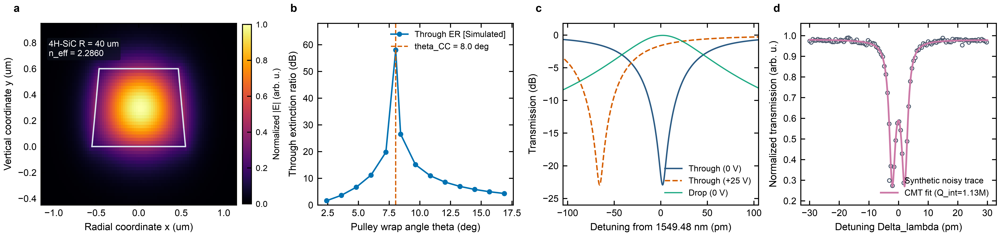
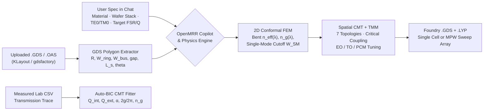

# OpenMRR Studio

**Design, sweep, fit, and lay out integrated photonic microring resonators — through a conversational AI copilot, interactive 2D workbench, and bidirectional GDSII bridge — with zero Ansys Lumerical, Synopsys RSoft, or COMSOL licenses.**

[English](./README.md) | [简体中文](./README_zh-CN.md) | [Chatbot & GDS Tutorial](./docs/tutorials/chatbot_and_gds_guide.md) | [Codex & Claude Agent Guide](./docs/tutorials/ai_agents_codex_claude.md) | [Roadmap](./ROADMAP.md)

[](./LICENSE)
[](./pyproject.toml)
[-0284c7.svg)](./src/openmrr/eigenmode_solver.py)
[](./src/openmrr/gds_bridge.py)
[](./src/openmrr/hardware_accel.py)


*Overview generated directly by `scripts/generate_hero_figure.py` without commercial solvers: **(a)** 2D full-vector cylindrical bent FEM eigenmode (`4H-SiC`, `R = 40 um`, `82 deg` sidewall), **(b)** concentric wrap-around pulley coupler sweep & automatic critical-coupling synthesis (`theta_CC`), **(c)** `X-cut TFLN` electro-optic racetrack resonance tuning (`0 V` vs `+25 V`), and **(d)** post-fabrication CW/CCW backscattering split-doublet CMT parameter extraction.*

---

## Why OpenMRR Studio?

Most photonics students and engineers face two painful bottlenecks when designing microring resonators (MRRs):
1. **Expensive commercial solver lock-in**: Checking single-mode waveguide cutoffs, bent radiation/dispersion, pulley coupler phase-matching, and resonance spectra normally requires expensive commercial licenses (`Ansys Lumerical MODE/FDTD`, `Synopsys RSoft`, or `COMSOL Multiphysics`).
2. **Layout-to-simulation disconnect**: A `.gds` mask drawn by a colleague in KLayout or `gdsfactory` has to be manually re-measured and re-typed into a mode solver, while simulation parameter sweeps rarely export directly into foundry-ready `.gds` test arrays.

**OpenMRR Studio** solves both problems in a single 100% permissive (`MIT`/`BSD`) Python package and native desktop app:
- **Conversational Photonics Copilot (English & 中文)**: Chat step-by-step about your target material, wafer stack (`H_film`, `H_slab`, sidewall angle, oxide vs air cladding), polarization (`TE0`/`TM0`), and target `FSR`/`Q`. The Copilot automatically runs 2D Maxwell width sweeps to find the single-mode cutoff, synthesizes the exact ring radius and critical-coupling gap/angle/length, runs tolerance sweeps, and exports `.gds` masks.
- **Bidirectional GDSII / OASIS Bridge**:
  - **Upload `.gds` / `.oas` $\rightarrow$ Simulate**: Drop any microring `.gds` file into the app. OpenMRR merges core polygons (`gdstk` + `shapely`), detects whether the layout is a **Point-Coupled Circle**, **Racetrack**, **Concentric Pulley**, or **Dual-Ring Vernier**, measures `R`, `W_ring`, `W_bus`, `gap_thru`, `gap_drop`, `L_s`, and `pulley_angle` directly from the polygons, renders an interactive 2D GDS caliper viewer, and simulates the optical spectrum once you confirm the wafer thickness.
  - **Design / Sweep $\rightarrow$ Create `.gds` + KLayout `.lyp`**: Export either a single annotated resonator cell (with optical port pins `65/0`, TiN heater `10/0`, GSG pads `11/0`) or a multi-device **MPW parameter-sweep array `.gds`** plus a matching KLayout `.lyp` color file.
- **7 Topologies & 18 Clean-Room Materials Built-In**:
  - **Topologies**: `point_circular_ap`, `point_circular_ad`, `racetrack_ap`, `racetrack_ad`, `pulley_ap`, `pulley_ad`, and `vernier_crow_ad` (2nd-order CROW / Vernier filter).
  - **Materials**: `Si (SOI)`, `a-Si:H`, `LPCVD Si3N4`, `Si-Rich SiNx`, `4H-SiC`, `3C-SiC`, `AlN`, `ScAlN (10% / 20% / 30% Sc)`, `Z-cut TFLN`, `X-cut TFLN` (with in-plane extraordinary/ordinary orientation averaging!), `Mid-IR Ge`, `Al2O3`, `SiO2`, `GSST` (amorphous & crystalline PCM), `Air`, and `Custom (n, k)`.
- **Hardware-Aware Across macOS & Windows (`CUDA GPU` vs `CPU`)**: Automatically probes **NVIDIA CUDA (`FP64`)** on Windows/Linux workstations, **Apple Silicon Accelerate AMX / Metal (`MLX`/`MPS`)** on M-series Macs, or **Multi-Core Vectorized CPU** on standard laptops (>25 Million wavelength pts/s for broadband TMM spectra).



---

## Quick Start (macOS & Windows)

We recommend [`uv`](https://docs.astral.sh/uv/) for a clean, reproducible Python 3.12 environment (standard `pip` also works).

### 1. Install `uv` (one-time) & Clone

```bash
# macOS / Linux:
curl -LsSf https://astral.sh/uv/install.sh | sh
# Windows PowerShell:
# irm https://astral.sh/uv/install.ps1 | iex

git clone https://github.com/ZhihaoRenKevin/openmrr-studio.git
cd openmrr-studio
```

### 2. Choose Your Platform Setup

| Platform | Command | Notes |
| :--- | :--- | :--- |
| **macOS (Apple Silicon M1–M5 / Intel)** | `uv sync --extra desktop --extra apple` | Uses Apple Accelerate AMX + native Cocoa window |
| **Windows / Linux (CPU-only Laptop)** | `uv sync --extra desktop` | Lightweight, zero GPU driver requirements |
| **Windows / Linux (NVIDIA CUDA GPU)** | `uv sync --extra desktop --extra cuda` | Accelerates massive broadband sweeps in `FP64` on RTX GPUs |
| **Developer + Test Suite** | `uv sync --extra desktop --extra dev` | Adds `pytest`, `httpx`, and `ruff` |

*(Standard `pip` alternative: `python -m venv .venv && source .venv/bin/activate && pip install -e ".[desktop,dev]"`)*

### 3. Launch the Interactive Desktop App (or Web UI)

```bash
# Launch native desktop window (auto-falls back to browser if pywebview is omitted):
uv run openmrr

# Or open directly in Chrome / Safari / Edge:
uv run openmrr browser

# Or double-click the platform launcher scripts:
#   macOS   : launchers/OpenMRR_macOS.command
#   Windows : launchers\OpenMRR_Windows.bat
```

### 4. Verify Hardware & Run the Step-by-Step Cookbook Recipes

```bash
# 0. Check GPU/AMX/CPU hardware backend, 100k-pt speed & 18 optical materials:
uv run python examples/00_getting_started/00_check_environment.py

# 1. Sweep waveguide width to find exact TE0 single-mode cutoff on 400 nm Si3N4:
uv run python examples/00_getting_started/01_waveguide_dispersion_sweep.py

# 2. Design 220 nm SOI racetrack add-drop & run coupler gap tolerance sweep:
uv run python examples/01_devices_and_sweeps/01_soi_point_and_racetrack.py

# 3. Synthesize 4H-SiC concentric pulley critical coupling & X-cut TFLN EO tuning:
uv run python examples/01_devices_and_sweeps/02_sin_and_sic_pulley_cc.py

# 4. Create single-device & 5-ring MPW sweep array .GDS + KLayout .lyp:
uv run python examples/02_gds_roundtrip/01_create_mrr_and_sweep_array_gds.py

# 5. Upload/read any external .GDS -> extract polygons -> simulate spectrum:
uv run python examples/02_gds_roundtrip/02_upload_and_simulate_gds.py

# 6. Fit CW/CCW split-doublet & multi-FSR experimental spectra via CMT:
uv run python examples/03_lab_spectrum_fitting/01_fit_doublet_and_multifsr.py

# Run automated test suite:
uv run pytest
```

---

## How to Use the Conversational Copilot & GDSII Workbench

### Workflow A: Designing an MRR From Scratch Through Chat
Open the **Photonics Design Copilot** on the left side of `OpenMRR Studio` and describe your goal naturally (or click the guided quick-reply chips):
1. **Specify Material & Wafer Stack**:
   > *"600 nm 4H-SiC strip waveguide, SiO2 clad, TE0 at 1550 nm"*
   The Copilot automatically sweeps waveguide widths with the 2D conformal FEM solver, reports the exact single-mode cutoff width (`TE1` onset), and recommends `W_bus` and `W_ring`.
2. **Specify Target FSR & Coupler Topology**:
   > *"FSR 150 GHz, concentric pulley all-pass"*
   Using the FEM group index $n_g$, the Copilot solves $R = \frac{c_0}{2\pi n_g \cdot \mathrm{FSR}}$, computes the 2D bent modes and spatial pulley coupling integral, plots the broadband spectrum, and reports the exact critical-coupling wrap angle $\theta_{\mathrm{CC}}$.
3. **Evaluate Sweeps & Export Foundry `.GDS`**:
   Click **`Apply Critical Coupling`**, type **`Sweep gap from 180 to 320 nm`**, or click **`Create 5-Ring Sweep Array .GDS`** to download both the `.gds` mask and KLayout `.lyp` layer map.

### Workflow B: Uploading an Existing `.GDS` / `.OAS` Layout to Simulate
1. Click **`+ .GDS`** in the Copilot bar (or drag-and-drop your `.gds` file onto **Tab 2: GDS Upload & Mask Creator**).
2. OpenMRR inspects the polygons, highlights the coupling gap with red caliper markers on the interactive zoom/pan 2D canvas, and posts the extracted `Topology`, `R`, `W_ring`, `W_bus`, `gap_thru`, `L_s`, and `pulley_angle` into the chat.
3. Because a 2D GDS mask does not store vertical thickness, click one of the wafer-stack confirmation chips (e.g. **`400 nm Si3N4 + Simulate GDS`** or type your custom `H_film` / `H_slab`) to compute the 2D modes and transmission spectrum immediately.

### Workflow C: 10-Line Python API

```python
from openmrr import MRRDesignConfig, export_mrr_gds, simulate_mrr_topology

cfg = MRRDesignConfig(
    topology="pulley_ap",
    core_material="Si3N4",
    film_height_um=0.40,
    ring_width_um=1.20,
    bus_width_um=0.95,
    ring_radius_um=50.0,
    gap_thru_um=0.25,
    pulley_angle_thru_deg=22.0,
    wavelength_nm=1550.0,
)
result = simulate_mrr_topology(cfg)
print(result["metrics"])              # FSR_GHz, Q_loaded, Q_int, ER_thru_dB, neff_ring, ng_ring
print(result["critical_coupling"])    # Exact recommended theta_CC [deg]
export_mrr_gds(cfg, "outputs/my_sin_pulley.gds")
```

### Workflow D: Ultra-Low-Token Integration with `Codex`, `Claude Code` & `MCP` (`<150 tokens/call`)

OpenMRR Studio ships with drop-in [`AGENTS.md`](./AGENTS.md), [`CLAUDE.md`](./CLAUDE.md), [`.mcp.json`](./.mcp.json), portable `.agents/skills/` + `.claude/skills/`, a zero-dependency **MCP stdio server** (`uv run openmrr mcp`), and a **compact JSON agent CLI** (`uv run openmrr agent ...`).
- **100% Local Compute + Persistent SSD Mode Cache**: 2D vector FEM modes, multi-point coupler sweeps, GPU/AMX broadband spectra, and GDS polygon measurements run locally and cache solved cross-sections in `outputs/.mode_cache/` (25x faster repeat sweeps!).
- **99% Token Reduction**: Full `.csv` spectra and `.gds`/`.lyp` masks are saved to `outputs/agent_runs/`, while Codex/Claude receives **only ~85–140 tokens of scalar KPI JSON** per tool call (see [docs/tutorials/ai_agents_codex_claude.md](./docs/tutorials/ai_agents_codex_claude.md)):

```bash
# Single-line JSON (<130 tokens) -> solves 2D FEM + target FSR + critical coupling + exports .GDS locally:
uv run openmrr agent design --top pulley_ap --mat 4H-SiC --h 0.60 --w-ring 1.10 --w-bus 0.82 --fsr 150 --gap 0.24 --cc --gds
```

---

## Repository Layout

```text
openmrr-studio/
├── pyproject.toml / .python-version       uv / Hatchling package config (MIT)
├── launchers/                             Double-clickable macOS (.command) & Windows (.bat) launchers
├── src/openmrr/
│   ├── materials.py                       18 clean-room materials (Sellmeier, anisotropy, dn/dT, r_ij, n2)
│   ├── conformal_mesher.py                Pure-BSD constrained Delaunay waveguide mesher (zero GPL)
│   ├── eigenmode_solver.py                2D full-vector Nedelec1/Lagrange FEM (bent + straight) & FDE
│   ├── mrr_cmt_spatial.py                 Cylindrical vector overlap & pulley spatial CMT integrator
│   ├── mrr_topologies.py                  7 MRR topologies, critical-coupling solver, EO/TO tuning & GDS
│   ├── sweeps.py                          Single-mode width cutoff sweep & MRR parameter sweep engine
│   ├── gds_bridge.py                      Bidirectional GDS/OAS polygon analyzer, sweep arrays & .lyp
│   ├── mrr_cmt_fit_predict.py             BIC lab spectrum fitter (Lorentzian, Doublet, Fano, Multi-FSR)
│   ├── hardware_accel.py                  Auto-probed CUDA FP64 / Apple AMX & MLX / CPU TMM accelerator
│   ├── copilot.py                         Conversational Photonics Design Copilot (EN/ZH + optional Ollama)
│   ├── app_server.py                      Local 127.0.0.1 Starlette ASGI backend
│   ├── ui_frontend.py                     Zero-CDN Retina 2x Canvas + SVG split-screen workbench
│   ├── desktop_app.py  cli.py             Native pywebview launcher & `openmrr` CLI
│   └── build_standalone.py                PyInstaller packager for macOS .app & Windows CPU/CUDA .exe
├── examples/                              7 self-contained cookbook scripts (Level 0 -> Level 3)
├── scripts/generate_hero_figure.py        Generates `docs/images/hero_openmrr_overview.{png,svg}` + CSVs
├── docs/                                  Tutorials & high-resolution overview figures
└── tests/                                 Automated pytest suite (FEM, CMT, sweeps, GDS roundtrip, API)
```

---

## Building Standalone Executables (`macOS .app` & `Windows .exe`)

Because OpenMRR Studio contains **zero GPL runtime dependencies**, you can distribute standalone binaries freely:

```bash
pip install pyinstaller
python -m openmrr.build_standalone --target macos          # macOS Apple Silicon .app
python -m openmrr.build_standalone --target windows-cpu    # Lightweight Windows 10/11 CPU .exe
python -m openmrr.build_standalone --target windows-cuda   # NVIDIA RTX CUDA-enabled Windows .exe
```

---

## Physical Scope, Verification & Limitations

- **2D Eigenmode + Spatial CMT Accuracy**: On standard weakly-to-moderately coupled integrated microrings (`gap >= 150 nm`), the 2D conformal vector FEM (`Nedelec1` transverse + `Lagrange P2` longitudinal with conformal cylindrical coordinate mapping) matches mesh-converged commercial FEM solvers to $|\Delta n_{\mathrm{eff}}| < 5 \times 10^{-4}$ while running in ~1–2 s on a laptop.
- **When Full 3D FDTD Is Still Needed**: Ultra-tight sub-`100 nm` gaps, abrupt pulley transition tapers, substrate leakage through thin buried oxide (`BOX`), and vertical scattering radiation loss ($Q_{\mathrm{rad}}$ in ultra-sharp bends) require 3D FDTD verification before final foundry tape-out.
- **2D Planar GDSII Scope**: GDSII/OASIS files encode in-plane `(x, y)` polygons only; vertical film thickness (`H_film`), partial-etch slab (`H_slab`), and sidewall angle must always be confirmed against your foundry's PDK design manual.

---

## Disclaimer

Material dispersion models and default layer numbers (`1/0` core, `2/0` slab, `10/0` heater, `11/0` pads) are compiled from peer-reviewed literature for optical design, education, and pre-tapeout prototyping. Always run your target foundry's official DRC deck and PDK rules prior to fabrication.

This project is an independent open-source effort and is not affiliated with or endorsed by Ansys, Inc., Synopsys, Inc., or COMSOL AB. *"Ansys"* and *"Lumerical"* are trademarks of Ansys, Inc.; *"RSoft"* is a trademark of Synopsys, Inc.; *"COMSOL Multiphysics"* is a trademark of COMSOL AB.

---

## Contributing, Citing & License

Contributions are welcome — see [CONTRIBUTING.md](./CONTRIBUTING.md) and [ROADMAP.md](./ROADMAP.md). If OpenMRR Studio helps your research or teaching, please cite it via [CITATION.cff](./CITATION.cff). Released under the [MIT License](./LICENSE).
