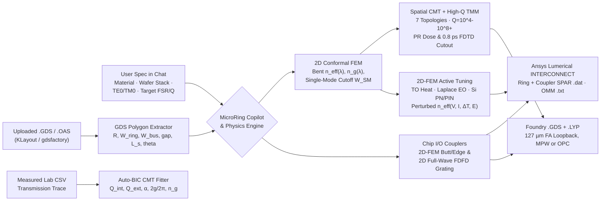

# MicroRing Studio

**License-free Photonic IC and Optical Interconnect CAD for microring resonators, Butt/Edge couplers, 2D Full-Wave `FDFD` Grating Couplers, instant Ultra-High-Q (`10^4` to `10^8+`) convergence, 2D-FEM modulators, bidirectional GDSII masks, and Ansys Lumerical INTERCONNECT export, with zero Lumerical MODE/FDTD, Synopsys RSoft, or COMSOL licenses.**

[English](./README.md) | [简体中文](./docs/README_zh-CN.md) | [Verification & Benchmarks](./docs/VERIFICATION_AND_BENCHMARKS.md) | [Chatbot & GDS Tutorial](./docs/tutorials/chatbot_and_gds_guide.md) | [Codex & Claude MCP Guide](./docs/tutorials/ai_agents_codex_claude.md) | [llms.txt](./docs/llms.txt) | [Changelog](./CHANGELOG.md)

[](https://codespaces.new/ZhihaoRenKevin/microring-studio?quickstart=1)
[](https://github.com/ZhihaoRenKevin/microring-studio/releases/latest)
[](https://github.com/ZhihaoRenKevin/microring-studio/releases/tag/v3.5.0)
[](./docs/VERIFICATION_AND_BENCHMARKS.md)
[](./docs/tutorials/ai_agents_codex_claude.md)
[](./LICENSE)
[](./pyproject.toml)


*Overview generated directly by `benchmarks/generate_hero_figure.py` without commercial solvers: **(a)** 2D full-vector cylindrical bent FEM eigenmode (`4H-SiC`, `R = 40 um`, `82 deg` sidewall), **(b)** concentric wrap-around pulley coupler sweep & automatic critical-coupling synthesis (`theta_CC`), **(c)** `X-cut TFLN` electro-optic racetrack resonance tuning (`0 V` vs `+25 V`), and **(d)** post-fabrication CW/CCW backscattering split-doublet CMT parameter extraction.*

---

## Why MicroRing Studio?

Photonic IC (`PIC`) and optical module interconnect engineers routinely hit three painful bottlenecks:
1. **Commercial solver lock-in across passive, active, and chip I/O blocks**: Designing waveguides, microring filters/modulators, fiber-to-chip Butt/Edge couplers, and surface Grating Couplers (`GC`) normally requires separate commercial licenses (`Ansys Lumerical MODE/FDTD/HEAT/CHARGE`, `Synopsys RSoft`, or `COMSOL Multiphysics`).
2. **High-Q microring non-convergence in time-domain FDTD**: For a low-loss `Si3N4`, `TFLN`, or `SiC` ring (`Q_loaded = 3 x 10^6`, `tau_ph = 2.49 ns`), reaching `auto shutoff min = 1e-5` in 3D FDTD requires **`28.6 ns` (`> 8,200` cavity round-trips)**; stopping FDTD early produces severe FFT sinc-ringing and collapses the apparent extinction ratio from `64 dB` down to `< 2 dB`.
3. **Layout-to-circuit disconnect**: A `.gds` mask drawn in KLayout or `gdsfactory` has to be manually re-measured for simulation, while device sweeps rarely export directly into `127 um` fiber-array test loops or `Ansys Lumerical INTERCONNECT` circuit compact models.

**MicroRing Studio (`v3.5.0`)** solves all three problems in a single 100% permissive (`MIT`/`BSD`) Python package and native desktop app:
- **Instant Ultra-High-Q (`Q = 10^4` to `10^8+`) Convergence & 0.8 ps FDTD Cutout (`🔌 Butt/GC & High-Q`)**:
  - Solves exact steady-state infinite-roundtrip ($M \to \infty$) spectra in `~1 s` on a Lorentzian-graded sub-femtometer (`0.1 fm`) `sinh` grid for any $Q$ up to $10^8+$, with zero time-domain ring-down stall.
  - Quantifies exact photon lifetime $\tau_{\mathrm{ph}}$, required `1e-5` FDTD simulation time, and finite-roundtrip truncation artifacts, and exports a single-pass **Coupler-Only 3D-FDTD Cutout (`.GDS` + `.lsf`)** requiring `< 1 ps` (`> 10,000x` faster than full-ring 3D FDTD).
- **100% License-Free Butt/Edge Couplers & 2D-FDFD Surface Grating Couplers (`🔌 Butt/GC & High-Q`, Zero Lumerical / COMSOL / RSoft)**:
  - **Butt / Edge Coupler (`design_butt_edge_coupler`)**: Sweeps inverse-taper facet tips via **2D conformal vector Maxwell FEM**, evaluates complex Poynting overlap against 8 target fiber and III-V DFB laser presets (`SMF28_1550`, `Lensed_2p5um`, `DFB_Laser_Butt`, `UHNA_3`, `MidIR_InF3`), computes Fresnel reflection, substrate `BOX` leakage, adiabatic EME taper length, and `1-dB / 3-dB` alignment tolerances ($\pm \Delta x, \pm \Delta y$).
  - **Surface Grating Coupler (`design_grating_coupler`)**: Synthesizes 2nd-order Rytov Bragg or Gaussian-apodized teeth and solves full-wave **2D Maxwell Frequency-Domain Finite-Difference (`2D FDFD` with `UPML`)** across etched grooves, top oxide, `BOX`, and bottom Si handle wafer (`~2.5 s` broadband `IL(λ)`, `S11(λ)`, and 2D radiated $|E(z,y)|$ beam map).
  - **127 um Fiber-Array Loopback `.GDS` & INTERCONNECT `SPAR` Export**: Exports curved focusing GC or inverse-taper edge-coupler `.GDS` cells, complete **`127 um` pitch fiber-array microring loopback + reference `.GDS` frames**, and passive-verified 2-port `SPAR .dat` `.zip` bundles for `Ansys Lumerical INTERCONNECT`.
- **6-Step Guided Bilingual Copilot (`EN | 中文`)**: A clean, zero-overload step-by-step assistant asking **one clear question at a time** (`1. Goal` → `2. Waveband` → `3. Material` → `4. Stack & 2D Mode` → `5. Propagation Loss dB/cm` → `6. Ring Topology, FSR & GDS`), with 1-click **`EN | 中文`** switching across all UI labels, choice chips, and responses (plus instant fast-forward when typing full specs).
- **Bidirectional Propagation Loss (`dB/cm`) Design & Spectrum Extraction**:
  - **Design from Known Loss (`dB/cm` $\rightarrow$ Critical Coupling)**: Enter your measured or foundry propagation loss $\alpha$ (`dB/cm`) or $Q_{\mathrm{int}}$, and MicroRing converts $Q_{\mathrm{int}} = \frac{20\pi n_g}{\ln(10)\,\lambda\,\alpha}$ to synthesize the exact critical-coupling gap, pulley wrap angle $\theta_{\mathrm{CC}}$, or racetrack coupler length $L_{\mathrm{CC}}$, and sweeps performance across loss tolerances.
  - **Extract Loss from Measured Spectra (`.CSV` $\rightarrow$ `dB/cm` $\rightarrow$ Design)**: Upload linear-power or logarithmic `dB`/`dBm` lab spectra to fit Lorentzian, CW/CCW backscattering split-doublet, Fano, or broadband multi-FSR traces (extracting both $n_g$ and $\alpha$ in `dB/cm`), then click **`🎯 Design Ring with α`** to feed your measured loss straight into new mask synthesis.
- **Bidirectional GDSII / OASIS Bridge**:
  - **Upload `.gds` / `.oas` $\rightarrow$ Simulate**: Drop any microring `.gds` file into the app. MicroRing merges core polygons (`gdstk` + `shapely`), detects whether the layout is a **Point-Coupled Circle**, **Racetrack**, **Concentric Pulley**, or **Dual-Ring Vernier**, measures `R`, `W_ring`, `W_bus`, `gap_thru`, `gap_drop`, `L_s`, and `pulley_angle` directly from the polygons, renders an interactive 2D GDS caliper viewer, and simulates the optical spectrum once you confirm the wafer thickness.
  - **Design / Sweep $\rightarrow$ Create `.gds` + KLayout `.lyp`**: Export either a single annotated resonator cell (with optical port pins `65/0`, TiN heater `10/0`, GSG pads `11/0`) or a multi-device **MPW parameter-sweep array `.gds`** plus a matching KLayout `.lyp` color file.
- **Native 2D-FEM Active Tuning (`TO` / `EO` / `Si PN-PIN`) & Ansys Lumerical INTERCONNECT Export (`⚡ Tuning & IC`, Zero COMSOL)**:
  - Solves cross-section multiphysics directly in pure Python (`scikit-fem`) without COMSOL: **2D Fourier heat conduction** ($-\nabla\cdot(\kappa_{\mathrm{th}}\nabla \Delta T)=Q_{\mathrm{vol}}$ across `TiN`/`Pt`/`W` microheaters and `BOX` oxide thickness), **2D anisotropic Laplace electrostatics** ($-\nabla\cdot(\varepsilon_0\boldsymbol{\varepsilon}_{\mathrm{DC}}\nabla\phi)=0$ across coplanar `GSG` or vertical electrodes with dielectric screening), and **2D Silicon PN depletion / PIN injection** (Debye-screened carriers, Soref-Bennett complex $\Delta n + i\Delta k$, junction capacitance $C_j(V)$, and slab resistance $R_s$).
  - Feeds spatial $\tilde{n}(x,y) = n_0 + \Delta n(x,y) + i(k_0 + \Delta k(x,y))$ directly into the **2D conformal vector Maxwell eigenmode solver** across arbitrary **Voltage (`V`), Current (`mA`), Heater Power (`mW`), Temperature Shift (`ΔT [K]`), or Electric Field (`E [V/µm]`)** inputs, extracting $V_\pi L$, $P_\pi$, $f_{3\mathrm{dB}}$, multi-state spectra, and exporting turnkey **Ansys Lumerical INTERCONNECT** compact-model `.zip` bundles (`SPAR .dat`, `OMM n_eff .txt`, `.lsf`, and `lumapi` runner).
- **Cleanroom Lithography Dose & Photoresist Polarity Error Analysis (`🧪 Fab & Dose`)**:
  - Evaluates realistic **Over-Dose** and **Under-Dose** fabrication errors for both **Positive Photoresist** (`ZEP520A`, `CSAR 62`, `PMMA`, `KrF/ArF DUV`, where over-dose shrinks core width $W - |\Delta\mathrm{CD}|$, widens gap $g + \eta|\Delta\mathrm{CD}|$, shifts toward under-coupling, and blue-shifts resonance) and **Negative Photoresist** (`HSQ`, `ma-N 2403`, `SU-8`, or lift-off, where over-dose blooms core width $W + \Delta\mathrm{CD}$, shrinks gap $g - \eta\Delta\mathrm{CD}$ with proximity gap-bridging alerts, shifts toward over-coupling, and red-shifts resonance).
  - Extracts the **`ER >= 15 dB` CD & Exposure Dose Yield Window**, resonance sensitivity `dλ/dCD [pm/nm]`, TiN heater $\Delta T$ trim budget, and exports a **5-Cell Pre-Biased Compensation `.GDS` Array** (`ΔCD_drawn = [-20, -10, 0, +10, +20] nm`) so at least one cell on-wafer hits critical coupling despite dose drift.
- **7 Topologies & 24 Multi-Waveband Materials (`Visible 400 nm` $\rightarrow$ `O-Band 1310 nm` $\rightarrow$ `C-Band 1550 nm` $\rightarrow$ `SWIR 2 µm` $\rightarrow$ `Mid-IR 3–14 µm`)**:
  - **Topologies**: `point_circular_ap`, `point_circular_ad`, `racetrack_ap`, `racetrack_ad`, `pulley_ap`, `pulley_ad`, and `vernier_crow_ad` (2nd-order CROW / Vernier filter).
  - **Materials (24)**:
    - *Visible / VNIR / Quantum (`400–950 nm`)*: `TiO2` (anatase, athermal $dn/dT < 0$), `Ta2O5`, `GaN` (uniaxial), `Diamond` (UV–LWIR), `Al2O3`, `AlN`, `Si3N4`, `4H-SiC`, `LN Z/X-cut`.
    - *O-Band (`1310 nm`), C/L-Band (`1550 nm`) & SWIR (`2000 nm`)*: `Si (SOI)`, `a-Si:H`, `LPCVD Si3N4`, `Si-Rich SiNx`, `4H-SiC`, `3C-SiC`, `AlN`, `ScAlN (10% / 20% / 30% Sc)`, `Z-cut TFLN`, `X-cut TFLN` (in-plane orientation averaging), `GSST` (amorphous & crystalline PCM).
    - *Mid-IR (`3.0–14.0 µm`)*: `Ge` (`Ge-on-CaF2`, `Ge-on-MgF2`, `Ge-on-Si`), `Diamond`, `Si` (suspended / sapphire), `CaF2`, `MgF2`, `Air`, `SiO2` (with automatic $>3.6\text{ µm}$ multiphonon & interband absorption warnings!).
- **Hardware-Aware Across macOS & Windows (`CUDA GPU` vs `CPU`)**: Automatically probes **NVIDIA CUDA (`FP64`)** on Windows/Linux workstations, **Apple Silicon Accelerate AMX / Metal (`MLX`/`MPS`)** on M-series Macs, or **Multi-Core Vectorized CPU** on standard laptops (>25 Million wavelength pts/s for broadband TMM spectra).



---

## Installation & Launch: Offline Desktop OR Online Cloud / Claude / Codex

Zero Ansys Lumerical, COMSOL, or Synopsys RSoft licenses are required. Choose whichever way fits your workflow:

### Option 1: Install Offline Like Normal Desktop Software (`.dmg` & `.exe` - Zero Python Needed)

Download the pre-built desktop installer from [**GitHub Releases**](https://github.com/ZhihaoRenKevin/microring-studio/releases/latest):

| Operating System | Download Package | How to Install & Open |
| :--- | :--- | :--- |
| **macOS (Apple Silicon)** | [**`MicroRing-Studio-v3.5.0-macOS-AppleSilicon.dmg`**](https://github.com/ZhihaoRenKevin/microring-studio/releases/latest) | Open the `.dmg` and drag **`MicroRing Studio.app`** into **`Applications`**. *(On first launch of an unsigned open-source app, right-click **`MicroRing Studio.app`** $\rightarrow$ **Open**, or allow under **System Settings $\rightarrow$ Privacy & Security**.)* |
| **Windows 10 / 11 (64-bit)** | **`MicroRing-Studio-v3.5.0-Windows-Setup-x64.exe`** *(or Portable `.zip`)* | Double-click **`Setup.exe`** (no Admin password needed; creates Desktop & Start Menu shortcuts), or unzip the Portable `.zip` and run **`MicroRing Studio.exe`**. *(If building from source on Windows, see Option 3 below: 1 double-click on `launchers\MicroRing_Windows.bat`.)* |

*(Exported `.gds` masks, `.lyp` color maps, and `.csv` spectra from the standalone desktop app are saved locally in `~/Documents/MicroRing_Studio/`.)*

---

### Option 2: Run Online in Your Browser OR Connect `Claude` / `Codex`

1. **Zero-Install Cloud Browser (`GitHub Codespaces`)**:
   Click [**Run Online in GitHub Codespaces**](https://codespaces.new/ZhihaoRenKevin/microring-studio?quickstart=1). GitHub launches a cloud Python container and opens the full interactive MicroRing Studio web workbench on port `8765` in your browser with zero local setup.
2. **Switch Between Offline & Online AI Inside the Studio UI (`⚡ Offline` | `🖥 Ollama` | `🟣 Claude` | `🟢 Codex`)**:
   Use the AI Mode selector right above the chat box at any time:
   - **`⚡ Offline · Built-in Copilot` *(Default)***: 100% offline deterministic physics copilot (`0` tokens, works with no internet).
   - **`🖥 Offline · Local Ollama / MLX`**: Connects locally to `Ollama` (`127.0.0.1:11434`) or `LM Studio` (`127.0.0.1:1234`) with zero cloud data transfer.
   - **`🟣 Online · Claude` & `🟢 Online · Codex / OpenAI`**: Automatically uses your locally signed-in **`claude` (`Claude Code` CLI)** or **`codex` (`OpenAI Codex` CLI)** subscription with zero extra API key, or accepts an optional in-memory API key via **`🔑 Key`**. All 2D Maxwell FEM modes, CMT spectra, and `.GDS` masks are still solved locally for exact accuracy while sending `< 150 tokens` of summary state to Claude/Codex!
3. **Run Directly Inside `Claude Code` or `Codex` Terminal/Desktop (`MCP` `< 150 tokens/call`)**:
   Open the cloned `microring-studio` folder in **Claude Code** (`claude`) or **OpenAI Codex** (`codex`). Both agents automatically detect [`AGENTS.md`](./AGENTS.md) and [`.mcp.json`](./.mcp.json) to design rings, evaluate positive/negative PR dose tolerance, sweep gaps/losses, fit `.CSV` spectra, and export `.GDS` masks on command.

---

### Option 3: Download Source ZIP + 1-Click Auto-Setup Launcher (Python 3.11+)

If you have **Python 3.11, 3.12, or 3.13** installed from [python.org/downloads](https://www.python.org/downloads/) *(on Windows, check **`Add python.exe to PATH`** during install)*:

1. Click the green **`<> Code`** button at the top of this page $\rightarrow$ **`Download ZIP`**, and extract the `microring-studio` folder anywhere on your PC.
2. Open `launchers/` and double-click the launcher for your OS:
   - **Windows 10 / 11**: Double-click **`launchers\MicroRing_Windows.bat`**
   - **macOS**: Right-click **`launchers/MicroRing_macOS.command`** $\rightarrow$ **Open**
3. **First launch (~1 minute)**: Automatically creates `.venv`, installs all scientific Python packages, and opens **MicroRing Studio** (subsequent launches open in `< 2 seconds`).

---

### Option 4: Developer / Python Scripting Setup (`git` + `pip`)

#### On Windows 10 / 11 (`PowerShell` or `Command Prompt`)
```powershell
git clone https://github.com/ZhihaoRenKevin/microring-studio.git
cd microring-studio

python -m venv .venv
.venv\Scripts\activate
pip install -U pip
pip install -e ".[desktop]"

# Launch the interactive Studio:
microring
```

#### On macOS or Linux (`Terminal`)
```bash
git clone https://github.com/ZhihaoRenKevin/microring-studio.git
cd microring-studio

python3 -m venv .venv
source .venv/bin/activate
pip install -U pip
pip install -e ".[desktop]"

# Launch the interactive Studio:
microring
```

> **Desktop Window vs. Web Browser**:
> - `microring` opens a native desktop window (and automatically falls back to your browser if `pywebview` is omitted).
> - `microring browser` opens the Studio directly in Chrome / Edge / Safari at `http://127.0.0.1:8765` (still 100% local and offline).

<details>
<summary><b>Conda, <code>uv</code>, or NVIDIA CUDA / Apple Silicon GPU Extras (Click to expand)</b></summary>

#### Using Conda / Miniforge
```bash
conda create -n microring python=3.12 -y
conda activate microring
git clone https://github.com/ZhihaoRenKevin/microring-studio.git
cd microring-studio
pip install -e ".[desktop]"
microring
```

#### Using `uv` (Fastest Reproducible Setup + Hardware Extras)
```bash
# Install uv once (macOS/Linux: curl -LsSf https://astral.sh/uv/install.sh | sh)
git clone https://github.com/ZhihaoRenKevin/microring-studio.git
cd microring-studio

# Standard CPU / Laptop (Windows, macOS, Linux):
uv sync --extra desktop

# NVIDIA RTX GPU Workstation (Windows / Linux FP64 CUDA acceleration):
uv sync --extra desktop --extra cuda

# Apple Silicon Mac (AMX + Metal MLX acceleration):
uv sync --extra desktop --extra apple

# Launch:
uv run microring
```
</details>

---

### Optional: Verify Your Setup & Run the Cookbook Examples

With your `.venv` (or Conda environment) activated:

```bash
# 0. Check CPU/GPU backend, 100k-pt TMM speed & 24 optical materials:
python examples/00_getting_started/00_check_environment.py

# 1. Sweep waveguide width to find exact TE0 single-mode cutoff on 400 nm Si3N4:
python examples/00_getting_started/01_waveguide_dispersion_sweep.py

# 2. Design 220 nm SOI racetrack add-drop & run coupler gap tolerance sweep:
python examples/01_devices_and_sweeps/01_soi_point_and_racetrack.py

# 3. Synthesize 4H-SiC concentric pulley critical coupling & X-cut TFLN EO tuning:
python examples/01_devices_and_sweeps/02_sin_and_sic_pulley_cc.py

# 3b. Multi-waveband showcase: Visible 532/780 nm, O-band 1310 nm, SWIR 2 um & Mid-IR 4.2/7.5 um:
python examples/01_devices_and_sweeps/03_multiband_vis_1310_midir.py

# 3c. Lithography over-dose / under-dose (Positive PR vs Negative PR) & 5-cell pre-biased .GDS:
python examples/01_devices_and_sweeps/04_lithography_dose_pr_tolerance.py

# 3d. Native 2D-FEM TO/EO/Si-PN active tuning (V / I / dT / E) & Lumerical INTERCONNECT export:
python examples/01_devices_and_sweeps/05_active_tuning_pn_eo_to_interconnect.py

# 3e. License-free Butt/Edge coupler, 2D-FDFD Grating Coupler & High-Q (Q > 3e6) FDTD convergence:
python examples/01_devices_and_sweeps/06_butt_gc_couplers_and_high_q_fdtd.py

# 4. Create single-device & 5-ring MPW sweep array .GDS + KLayout .lyp:
python examples/02_gds_roundtrip/01_create_mrr_and_sweep_array_gds.py

# 5. Upload/read any external .GDS -> extract polygons -> simulate spectrum:
python examples/02_gds_roundtrip/02_upload_and_simulate_gds.py

# 6. Fit CW/CCW split-doublet & multi-FSR experimental spectra via CMT:
python examples/03_lab_spectrum_fitting/01_fit_doublet_and_multifsr.py

# Run all 12 automated verification suites:
python tests/test_microring_all.py
```

---

## How to Use the Conversational Copilot & GDSII Workbench

### Workflow A: Designing an MRR From Scratch Through Chat
Open the **Photonics Design Copilot** on the left side of `MicroRing Studio` and describe your goal naturally (or click the guided quick-reply chips):
1. **Specify Material & Wafer Stack**:
   > *"600 nm 4H-SiC strip waveguide, SiO2 clad, TE0 at 1550 nm"*
   The Copilot automatically sweeps waveguide widths with the 2D conformal FEM solver, reports the exact single-mode cutoff width (`TE1` onset), and recommends `W_bus` and `W_ring`.
2. **Specify Target FSR & Coupler Topology**:
   > *"FSR 150 GHz, concentric pulley all-pass"*
   Using the FEM group index $n_g$, the Copilot solves $R = \frac{c_0}{2\pi n_g \cdot \mathrm{FSR}}$, computes the 2D bent modes and spatial pulley coupling integral, plots the broadband spectrum, and reports the exact critical-coupling wrap angle $\theta_{\mathrm{CC}}$.
3. **Evaluate Sweeps & Export Foundry `.GDS`**:
   Click **`Apply Critical Coupling`**, type **`Sweep gap from 180 to 320 nm`**, or click **`Create 5-Ring Sweep Array .GDS`** to download both the `.gds` mask and KLayout `.lyp` layer map.

### Workflow B: Uploading an Existing `.GDS` / `.OAS` Layout to Simulate
1. Click **`+ .GDS`** in the Copilot bar (or drag-and-drop your `.gds` file onto **Tab 2: GDS Upload & Mask Creator**).
2. MicroRing inspects the polygons, highlights the coupling gap with red caliper markers on the interactive zoom/pan 2D canvas, and posts the extracted `Topology`, `R`, `W_ring`, `W_bus`, `gap_thru`, `L_s`, and `pulley_angle` into the chat.
3. Because a 2D GDS mask does not store vertical thickness, click one of the wafer-stack confirmation chips (e.g. **`400 nm Si3N4 + Simulate GDS`** or type your custom `H_film` / `H_slab`) to compute the 2D modes and transmission spectrum immediately.

### Workflow C: 10-Line Python API

```python
from microring import MRRDesignConfig, export_mrr_gds, simulate_mrr_topology

cfg = MRRDesignConfig(
    topology="pulley_ap",
    core_material="Si3N4",
    film_height_um=0.40,
    ring_width_um=1.20,
    bus_width_um=0.95,
    ring_radius_um=50.0,
    gap_thru_um=0.25,
    pulley_angle_thru_deg=22.0,
    wavelength_nm=1550.0,
)
result = simulate_mrr_topology(cfg)
print(result["metrics"])              # FSR_GHz, Q_loaded, Q_int, ER_thru_dB, neff_ring, ng_ring
print(result["critical_coupling"])    # Exact recommended theta_CC [deg]
export_mrr_gds(cfg, "outputs/my_sin_pulley.gds")
```

### Workflow D: Ultra-Low-Token Integration with `Codex`, `Claude Code` & `MCP` (`<150 tokens/call`)

MicroRing Studio ships with drop-in [`AGENTS.md`](./AGENTS.md), [`.mcp.json`](./.mcp.json), a zero-dependency **MCP stdio server** (`uv run microring mcp`), and a **compact JSON agent CLI** (`uv run microring agent ...`).
- **100% Local Compute + Persistent SSD Mode Cache**: 2D vector FEM modes, multi-point coupler sweeps, GPU/AMX broadband spectra, and GDS polygon measurements run locally and cache solved cross-sections in `outputs/.mode_cache/` (25x faster repeat sweeps!).
- **99% Token Reduction**: Full `.csv` spectra and `.gds`/`.lyp` masks are saved to `outputs/agent_runs/`, while Codex/Claude receives **only ~85–140 tokens of scalar KPI JSON** per tool call (see [docs/tutorials/ai_agents_codex_claude.md](./docs/tutorials/ai_agents_codex_claude.md)):

```bash
# Single-line JSON (<130 tokens) -> solves 2D FEM + target FSR + critical coupling + exports .GDS locally:
uv run microring agent design --top pulley_ap --mat 4H-SiC --h 0.60 --w-ring 1.10 --w-bus 0.82 --fsr 150 --gap 0.24 --cc --gds

# Lithography over-dose / under-dose (Positive PR vs Negative PR) + 5-cell pre-biased .GDS (<140 tokens):
uv run microring agent fab-tolerance --mat Si --h 0.22 --w-ring 0.48 --w-bus 0.45 --r 15 --gap 0.18 --resist positive_pr --dose-pct 15 --bias-gds

# 2D-FEM Si PN / Pockels EO / TO active tuning + Lumerical INTERCONNECT export (<145 tokens):
uv run microring agent active-tuning --mat Si --h 0.22 --slab 0.09 --w-ring 0.48 --w-bus 0.44 --r 20 --mech si_pn_depletion --biases "0,-2,-5" --interconnect

# Apodized focusing 2D-FDFD grating coupler + 127 um fiber-array loopback .GDS + INTERCONNECT (<145 tokens):
uv run microring agent io-coupler --type grating_coupler --mat Si --h 0.22 --etch 0.07 --loopback --interconnect

# High-Q convergence diagnostic vs truncated 3D-FDTD + 0.8 ps Coupler-Only Cutout .GDS/.lsf (<140 tokens):
uv run microring agent high-q --mat Si3N4 --top pulley_ap --r 100 --loss 0.08 --gap 0.42 --cutout
```

---

## Repository Layout

```text
microring-studio/
├── pyproject.toml                         Hatchling / uv package config (MIT)
├── launchers/                             1-click macOS (.command) & Windows (.bat) launchers
├── packaging/                             Windows Inno Setup (.iss) & installer CI workflow
├── .devcontainer/                         1-click GitHub Codespaces cloud browser configuration
├── src/microring/
│   ├── materials.py                       24 multi-band materials (Vis -> O/C -> Mid-IR, dn/dT, r_ij, k)
│   ├── conformal_mesher.py                Pure-BSD constrained Delaunay waveguide mesher (zero GPL)
│   ├── eigenmode_solver.py                2D full-vector Nedelec1/Lagrange FEM (bent + straight) & FDE
│   ├── mrr_cmt_spatial.py                 Cylindrical vector overlap & pulley spatial CMT integrator
│   ├── mrr_topologies.py                  7 MRR topologies, High-Q convergence, coupler cutout & GDS
│   ├── io_couplers.py                     2D-FEM Butt/Edge couplers & 2D Full-Wave FDFD Grating Couplers
│   ├── active_tuning.py                   2D-FEM TO/EO/Si-PN active tuning & Lumerical INTERCONNECT export
│   ├── fab_tolerance.py                   Positive/Negative PR over/under-dose & CD-bias error analyzer
│   ├── sweeps.py                          Single-mode width cutoff sweep & MRR parameter sweep engine
│   ├── gds_bridge.py                      Bidirectional GDS/OAS polygon analyzer, sweep arrays & .lyp
│   ├── mrr_cmt_fit_predict.py             BIC lab spectrum fitter (Lorentzian, Doublet, Fano, Multi-FSR)
│   ├── hardware_accel.py                  Auto-probed CUDA FP64 / Apple AMX & MLX / CPU TMM accelerator
│   ├── copilot.py                         Conversational Photonics Copilot (Offline + Ollama/Claude/Codex)
│   ├── app_server.py                      Local 127.0.0.1 Starlette ASGI backend
│   ├── ui_frontend.py                     Zero-CDN Retina 2x Canvas + SVG split-screen workbench
│   ├── desktop_app.py  cli.py             Native pywebview launcher & `microring` CLI
│   └── build_standalone.py                PyInstaller packager for macOS .dmg & Windows Setup .exe
├── examples/                              10 self-contained cookbook scripts (Visible -> 1310/1550 -> Mid-IR)
├── benchmarks/                            FEM vs Yee-FDE audit, Lumerical runner & hero figure generator
├── docs/                                  Chinese README, tutorials, benchmarks, contributing & llms.txt
└── tests/                                 12-suite automated verification tests
```

---

## Building Consumer Installers (`macOS .dmg` & `Windows Setup .exe`)

Because MicroRing Studio contains **zero GPL runtime dependencies**, you can build standalone desktop installers directly from source:

```bash
pip install -e ".[desktop]" pillow pyinstaller

# macOS -> builds dist/MicroRing Studio.app + drag-to-Applications .dmg:
python -m microring.build_standalone --target macos

# Windows 10/11 -> builds Inno Setup .exe installer + portable .zip:
python -m microring.build_standalone --target windows-cpu
python -m microring.build_standalone --target windows-cuda
```
*(A ready-to-run GitHub Actions cloud builder for both Windows `.exe` and macOS `.dmg` is also provided in [`packaging/build_installers_workflow.yml`](./packaging/build_installers_workflow.yml).)*

---

## Physical Scope, Verification & Limitations

- **2D Eigenmode + Spatial CMT + Instant High-Q Accuracy**: On standard weakly-to-moderately coupled integrated microrings (`gap >= 150 nm`), the 2D conformal vector FEM (`Nedelec1` transverse + `Lagrange P2` longitudinal with conformal cylindrical coordinate mapping) matches mesh-converged commercial FEM solvers to $|\Delta n_{\mathrm{eff}}| < 5 \times 10^{-4}$ while solving steady-state High-Q resonances ($Q = 10^4$ to $10^8+$) in `~1 s` without time-domain ring-down error.
- **2D Sagittal FDFD Grating Couplers & 2D-FEM Butt Couplers**: `design_grating_coupler` solves full-wave 2D Maxwell `FDFD` across etched grooves, `BOX`, and bottom Si substrate combined with analytical lateral width-to-Gaussian overlap, which accurately captures uniform and apodized curved-focusing gratings (`W_gc ~ 10-14 um`) in `~2.5 s`. Subwavelength metamaterial (`SWG` 2D pillar) gratings, dual-polarization 2D GCs, and ultra-short non-adiabatic 3D spot-size converters still require 3D FDTD verification before final tape-out.
- **When Full 3D FDTD Is Still Needed**: Ultra-tight sub-`120 nm` gaps, abrupt pulley transition tapers, substrate leakage through thin buried oxide (`BOX`), and vertical scattering radiation loss ($Q_{\mathrm{rad}}$ in ultra-sharp bends) require 3D FDTD verification (for High-Q rings, use `export_coupler_cutout_gds` to run a `< 1 ps` single-pass 3D FDTD on the coupler region only).
- **2D Planar GDSII Scope**: GDSII/OASIS files encode in-plane `(x, y)` polygons only; vertical film thickness (`H_film`), partial-etch slab (`H_slab`), and sidewall angle must always be confirmed against your foundry's PDK design manual.

---

## Disclaimer

Material dispersion models and default layer numbers (`1/0` core, `2/0` slab, `10/0` heater, `11/0` pads) are compiled from peer-reviewed literature for optical design, education, and pre-tapeout prototyping. Always run your target foundry's official DRC deck and PDK rules prior to fabrication.

This project is an independent open-source effort and is not affiliated with or endorsed by Ansys, Inc., Synopsys, Inc., or COMSOL AB. *"Ansys"* and *"Lumerical"* are trademarks of Ansys, Inc.; *"RSoft"* is a trademark of Synopsys, Inc.; *"COMSOL Multiphysics"* is a trademark of COMSOL AB.

---

## Author, Citing & License

- **Author**: **Zhihao Ren** ([ORCID: 0000-0002-2520-0784](https://orcid.org/0000-0002-2520-0784))
- **Citation**: If MicroRing Studio helps your research, tape-out, or teaching, please cite it via GitHub's *"Cite this repository"* button or [CITATION.cff](./CITATION.cff).
- **Contributing & License**: Contributions are welcome (see [CONTRIBUTING.md](./docs/CONTRIBUTING.md)). Released for free under the permissive [MIT License](./LICENSE).
